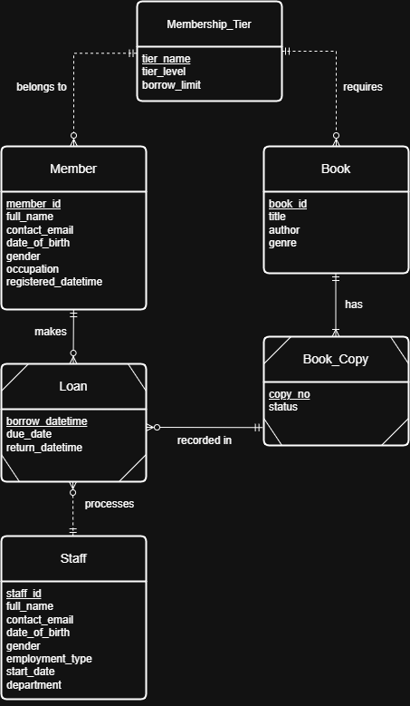
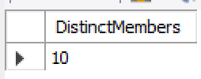
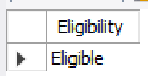

# Green Grass Library — Relational Database & SQL Analysis

  

**A relational database case study for a multi-tier library borrowing system.** I designed and implemented a six-table MySQL schema to represent members, membership restrictions, physical book copies and borrowing history, then used SQL queries to analyse borrower activity and lending eligibility.

**Tech:** MySQL · SQL · EERD · Relational Database Design · Joins · Aggregations · Subqueries · Foreign Keys

## At a glance

| | Historical coursework record |
|---|---:|
| Entities implemented | **6** |
| Imported members / staff | **10 / 10** |
| Book titles / physical copies | **20 / 70** |
| Borrowing transactions | **1,000** |
| Borrowing tiers | **Basic / Advanced / Premium** |

These are **recorded submission counts**, not counts verified by executing this repository's synthetic demo. See [Results & evidence](docs/results.md).

## Database design

The schema separates titles (`Book`) from physical copies (`BookCopy`), stores borrowing transactions in `Loan`, and centralises tier rules in `MembershipTier`. Member and book tier references support lending eligibility checks; the loan table links the member, staff member and specific physical copy.



[View the MySQL implementation diagram](assets/mysql_schema_diagram.png) · [Design decisions & limitations](docs/decisions_and_limitations.md)

## SQL use cases

| Question | Approach | Recorded finding |
|---|---|---|
| **Repeat borrowing** | `JOIN` + `GROUP BY` + `HAVING` + outer `COUNT` | 10 members borrowed *Lonely Dance* more than once |
| **Membership upgrade** | `CASE` + correlated subqueries + date conditions | Member M1005 marked eligible |
| **Borrowing eligibility** | Active loan count vs tier limit; compare tier levels | Member M1001 permitted to borrow |
| **Book-copy availability** | Filter `BookCopy` on book and `Available` status | Copy 4 of B1002 available |
| **Concurrency discussion** | Conditional update and affected-row check | Proposed mitigation; **not implemented as a transaction** |

The last item is a design analysis, not a completed production workflow. See [Borrowing workflow](docs/borrowing_workflow.md).

### Evidence from the submitted SQL results





## Repository structure

```text
green-grass-library-sql/
├── README.md
├── .gitignore
├── sql/
│   ├── 01_schema.sql             # Submitted six-table schema, transcribed
│   ├── 02_demo_data.sql          # Newly authored synthetic examples
│   └── 03_analysis_queries.sql   # Submitted Q1–Q3 SELECT queries
├── assets/                    # Submitted diagrams and result screenshots
└── docs/
    ├── decisions_and_limitations.md
    ├── borrowing_workflow.md
    └── results.md
```

## Reproduce with MySQL 8+

The original Excel input workbook was not included in the submission ZIP, so **this repo does not redistribute the original coursework dataset**. Instead, `02_demo_data.sql` contains a minimal, explicitly synthetic dataset for exercising the schema and SELECT queries.

From the repository root, with MySQL installed and running:

```bash
mysql -u root -p < sql/01_schema.sql
mysql -u root -p green_grass_library < sql/02_demo_data.sql
mysql -u root -p green_grass_library < sql/03_analysis_queries.sql
```

Run against a **fresh schema** (the demo uses fixed keys). The first command creates `green_grass_library` without deleting an existing database. The demo produces intentionally different counts from the historical class dataset; for example, Q1 returns one repeat borrower rather than ten.

> **Accuracy and scope:** SQL has been transcribed from the submitted Word report and checked structurally, but **not executed against a live MySQL server here**. The report's Q2 lost-book test uses present-day copy status as a stand-in for historical loss events, and the proposed borrowing operation lacks transactional guarantees. These limitations are explained in [Design decisions & limitations](docs/decisions_and_limitations.md).

## My contribution

Individual ST1501 Data Engineering coursework: relational design, MySQL DDL, query development and interpretation, and critical examination of lending rules and concurrent borrowing risks.

**Author:** Yun Fei · [GitHub](https://github.com/tyunfei) · [LinkedIn](https://www.linkedin.com/in/toh-yun-fei/)
